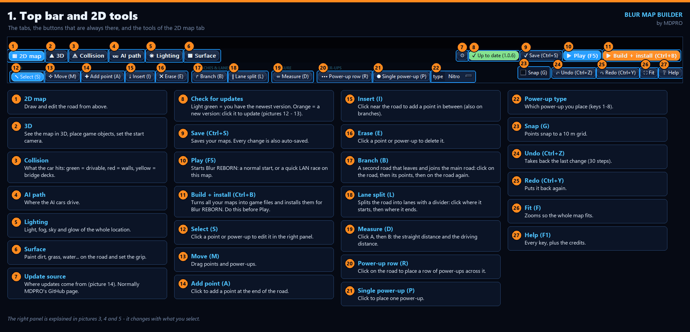

# Blur Map Builder — by MDPRO

> **Needs Blur PC version 1.2.** Blur 1.0 is not supported.

Make your own tracks for **Blur** (Bizarre Creations, 2010, PC): draw the road, add branches, lane splits, bridges,
power-ups, surfaces (dirt, water, varied asphalt, your own road picture...), hills and ramps, scenery, your own 3D
models (.glb) that can move (paths, keyframes, trigger boxes), lighting and skies — and your own cars (stats, paint,
wheels, sounds, your own .glb body), car skins and game tweaks — then race them in the game with **Blur REBORN**.

Since version 2.0 the map builder is written in **C# (.NET)**: one fast program, no Python needed. English and Russian.


## What you get

| File (in your Blur folder) | What it is |
|---|---|
| **Blur Map Builder.exe** | the map editor (2D map, 3D, landscape, surface, collision, AI path, lighting, custom car, car skins, game tweaks, export / import), Build + install |
| **Blur Map Tester.exe** | starts the game straight into a LAN race on the map you built last |
| **Blur REBORN.exe** | made on your PC from your own `Blur.exe`: plays the game with your maps |

Your original `Blur.exe` and the game's own files are **never changed** — normal Blur keeps working as before.

## Install (players)

1. Download **Blur Map Builder.exe** and **Blur Map Tester.exe** from the
   [latest release](../../releases/latest).
2. Put both into your **Blur game folder** (where `Blur.exe` is).
3. Start **Blur Map Builder.exe**. The first start sets everything up from your own game files (a few seconds,
   once). Nothing else to install: the program carries everything it needs.
4. Draw a map → **Build + install** → **Play** (or start **Blur Map Tester.exe**).

* Needs: **Blur for PC version 1.2** (retail / Steam) — it does **not** work with Blur 1.0; Windows 10/11. Amax (the Blur online mod) is needed for the quick-test LAN
  race (Map Tester); everything else works without it.
* Windows SmartScreen may warn about a new program: *More info → Run anyway*.
* Updates: the map builder checks this page when it starts and offers new versions. Your maps are kept
  (they live in `Blur Map Builder\maps` in your game folder).
* Something went wrong? The map builder saves a report in `Blur Map Builder\logs` — send it to **mdproii** on
  Discord.

## Problems?

**The first start stops at "Checking the game" ("not a version the map builder knows")**

Your `Blur.exe` is not the plain **version 1.2** exe. Two kinds seen so far:

| Your Blur.exe | Why it fails | What to do |
|---|---|---|
| The old **1.0** disc exe (about 21 MB, has SecuROM copy protection) | Different game code, and SecuROM refuses to start if the exe is changed at all | Update the game to **1.2** |
| A **modified / cracked** exe (e.g. about 29 MB, says 1.2.0.3) | The file is rebuilt, so the places the map builder changes are not where they should be | Use the plain 1.2 `Blur.exe` |

Still stuck? Send `Blur Map Builder\logs\setup.log` to **mdproii** on Discord — it says which Blur.exe you have
and why the setup stopped.

## Guide

**[How to use it — every button explained](docs/GUIDE.md)** (pictures of every tab).

[](docs/GUIDE.md)

## For developers

The map builder is C# on .NET 10 (Windows Forms + OpenGL). The source is in [`csharp/`](csharp):

```
cd csharp
dotnet build src/Bmb.App -c Release          # the map builder
dotnet publish src/Bmb.App -c Release -r win-x64 --self-contained true -p:PublishSingleFile=true -o publish
```

* `src/Bmb.App` — the window: tabs, 2D map, 3D view, Custom car, robot self-test
* `src/Bmb.Core` — the build: roads, surfaces, lighting, race path, level, cars, skins, readers / writers of the
  game's file formats (pak, kslf, model, textures)
* `src/Bmb.Cli` — `bmbcli`, look-only tools used while decoding the game
* `csharp/STATUS.md` — notes on how things work; `csharp/tools/README.md` — how to build and test

The old Python version (1.x) is still in the repository root (`road_designer.py`, `flat_earth/`, ...) for
reference; it is no longer updated.

## Credits

* **MDPRO** — Blur Map Builder
* **Bizarre Creations / Activision** — Blur (this is a free fan project; you need your own copy of the game)
* **The Amax team** — Amax
* **TimberStalker** — [BlurImportExport](https://github.com/TimberStalker/BlurImportExport) (how the game's model
  files are laid out)
* .NET, C#

License: MIT (the map builder's own code — see `LICENSE`).
