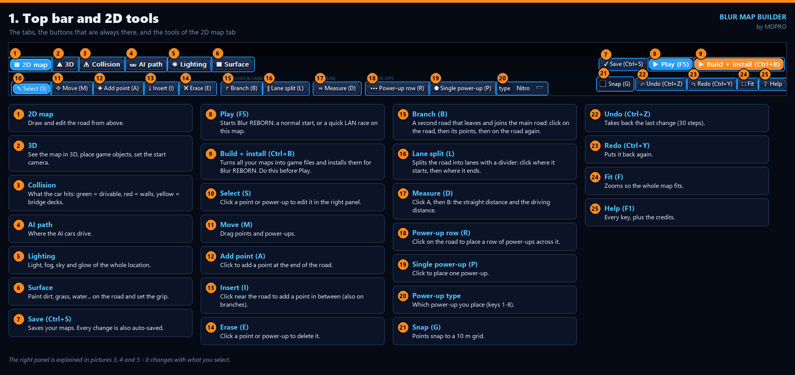
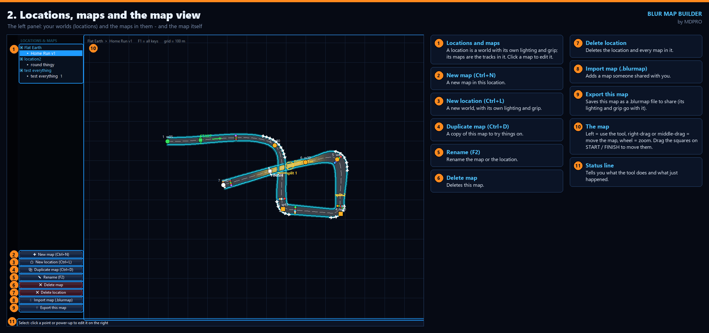
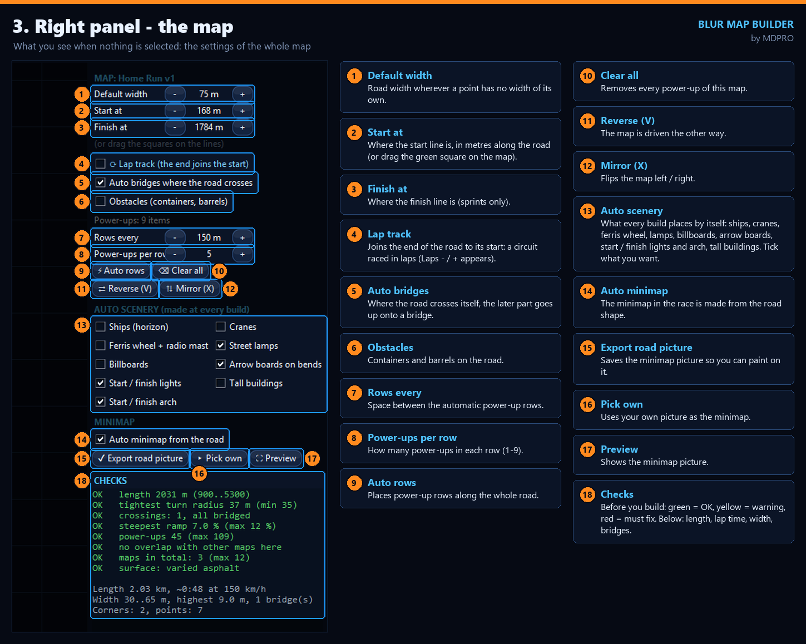
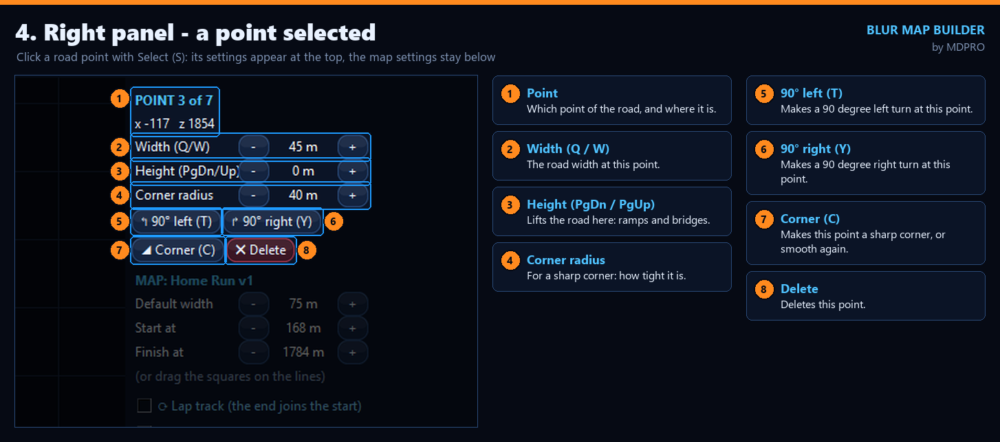
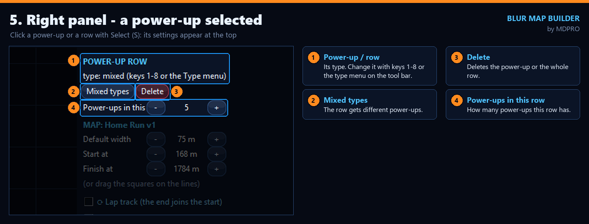
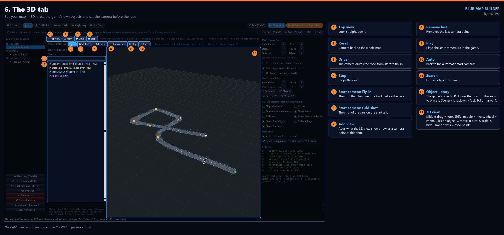
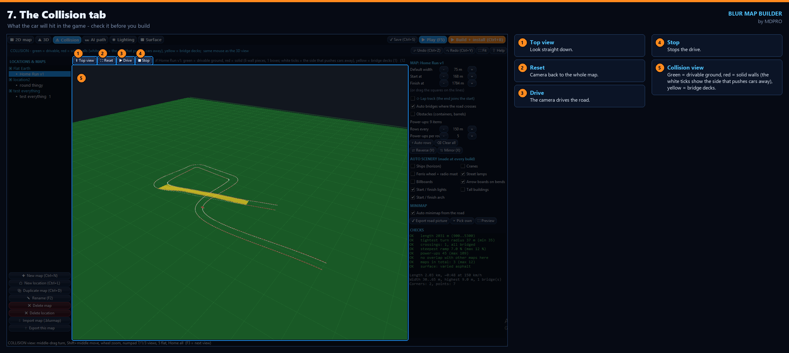
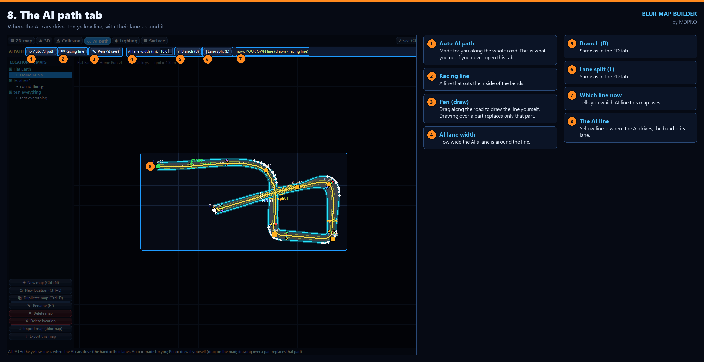
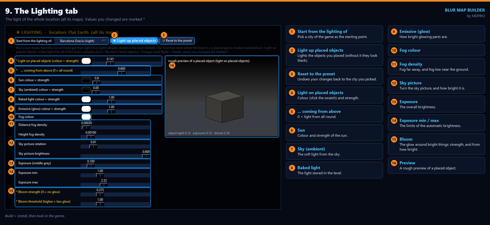
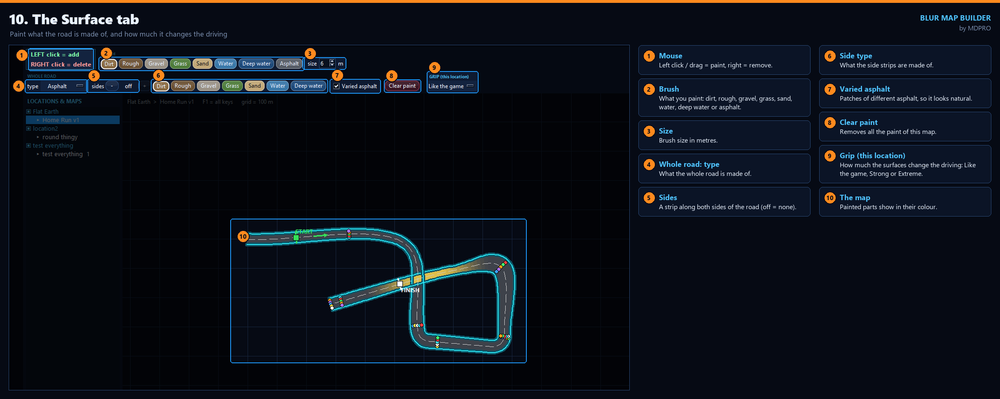

# Blur Map Builder — Guide

Every button of the map builder, tab by tab. The numbers on each picture match the list next to it.

> **Needs Blur PC version 1.2.** Install: see the [main page](../README.md#install-players).

## Your first map in 5 steps

1. **New map** (Ctrl+N) in the left panel, give it a name.
2. Pick **Add point (A)** and click on the map to draw the road. Use **Move (M)** to drag points.
3. **Auto rows** in the right panel puts power-ups along the road.
4. **Build + install** (Ctrl+B), wait until the Building window says it is done.
5. **Play** (F5): start Blur REBORN, or use **Blur Map Tester.exe** for a quick LAN race on your map.

Press **F1** in the map builder at any time to see every key.

---

## 1. Top bar and 2D tools
The tabs, the buttons that are always there (Save, Play, Build + install) and the tools of the 2D map tab.

## 2. Locations, maps and the map view
A **location** is a world with its own lighting and grip; its **maps** are the tracks in it.

## 3. Right panel — the map
What you see when nothing is selected: the settings of the whole map, the automatic scenery, the minimap and
the checks.

## 4. Right panel — a point selected
Click a road point with **Select (S)**: its settings appear at the top of the right panel.

## 5. Right panel — a power-up selected
Click a power-up or a row with **Select (S)**.

## 6. The 3D tab
See your map in 3D, place the game's own objects and set the camera before the race.

## 7. The Collision tab
What the car will hit in the game: check it before you build.

## 8. The AI path tab
Where the AI cars drive.

## 9. The Lighting tab
The light of the whole location (all its maps). Change it, Build + install, look in the game.

## 10. The Surface tab
Paint what the road is made of, and how much it changes the driving.

---

Problems? The map builder saves a report in `Blur Map Builder\logs` — send it to **mdproii** on Discord.

*(The pictures are made by `release/guide/capture_guide.py` and `annotate_guide.py`, so they can be made again
when the map builder changes.)*
